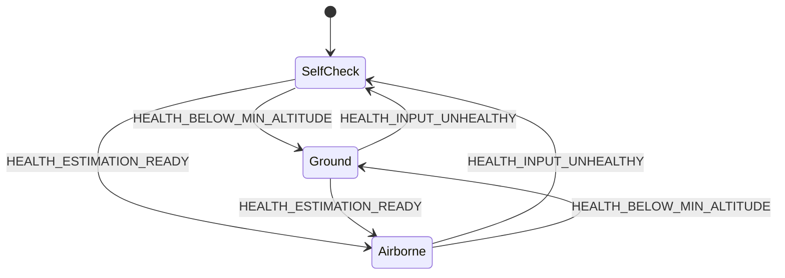
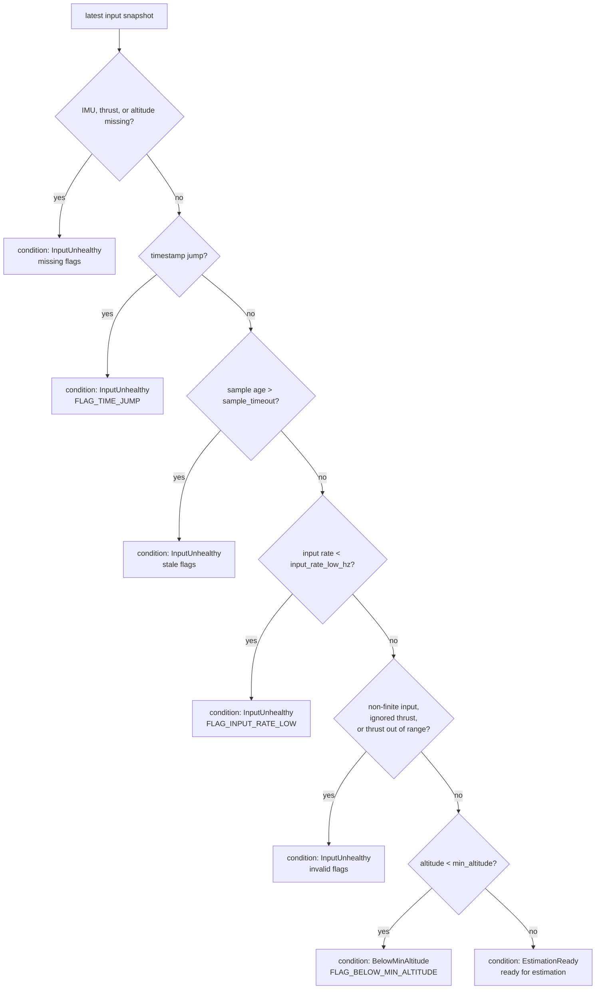

# Hover Thrust Estimator

## Shared runtime and ROS facade

The domain owns one shared `hover_thrust_estimator_math` runtime library.
`ingestImu`, `ingestThrust`, `ingestAltitude` and the test/owner `applyInput`
are `void` direct fact updates; they own sample periods, finite flags and
owner-local input marks. They do not return queue-admission status or log a
failure path. Callers pass the source timestamp and explicit event clock, then
`update(now)` once after an input batch or on an idle wake.
One causal owner turn evaluates the pending input health marks, evaluates health
at `now`, applies a condition-edge transition, runs the resulting state's due
raw/publication actions, and drives the output filter. Only the state-local
`PeriodicGate`s drive `publishedEstimates()`; the ROS output consumer publishes
those immutable records directly on the owner thread. The ROS facade handles
zero ROS header stamps at its edge. The runtime never replaces zero stamps with
a hidden clock. Default initial thrust remains 0.3; the existing publish/raw gates, safety limits and estimator
are unchanged.
ROS callbacks preserve each input topic's arrival order. A source clock
regression is never sorted into a healthy sequence. Shared ingestion retains a
batch time-jump flag until an update has observed it, so a later fresh sample
cannot hide the fault. The existing 8192 time-jump flag and `ready=false` remain
the original health outcome; tolerances come from the unchanged sample-timing
helper.

The ROS owner loop arms one one-shot `ros::Timer` at `nextWake()`'s ROS-clock
deadline and blocks on the existing global callback queue. Input callbacks and
that timer wake the same owner; a paused simulation clock does not cause a
wall-clock polling loop. Noetic's timer manager performs its stock 1 ms
simulation-time check while a ROS timer is armed; the owner thread itself does
not wake at that rate. Publication/raw phase and sample-timeout boundaries come
from the unchanged runtime gates.

A ROS-free build of the runtime is explicit:

```sh
cmake -S hover_thrust_estimator -B build-core -DBUILD_ROS=OFF \
  -DCMAKE_PREFIX_PATH="$private_prefix" -DCMAKE_INSTALL_PREFIX="$private_prefix"
cmake --build build-core -j1
(cd build-core && ctest --output-on-failure)
cmake --install build-core
```

The private prefix must contain the math development package and the
state-machine ADT headers. The hover runtime links no state-machine shared
library; its exported config adds `XGC2_STATE_MACHINE_INCLUDE_DIRS` for
`adt_machine.hpp`. Installed core consumers use
`find_package(HoverThrustEstimator CONFIG REQUIRED)` and
`HoverThrustEstimator::Runtime`.

The package candidate separates the shared runtime (`libxgc2-hover-thrust-core0`),
the headers/CMake target (`libxgc2-hover-thrust-dev`) and the ROS transport
package, which requires the exact same core package version. The historical
`/opt/ros/noetic` install prefix is retained for compatibility; using that
directory does not introduce ROS dependencies into the core ELFs. Local
build/package evidence does not establish APT publication.

Core tests retain the estimator, rejection, state-gate and health regressions and
add runtime boundary coverage for ingestion, publication and wake deadlines. The ROS facade test
(`hover_thrust_ros_facade_test`) runs the real input producer and output
consumer on a private ROS master: it checks that a backward stamp is ingested in
arrival order and raises the time-jump fault, that the published ROS message
carries the runtime's state, flags, hover thrust and stamp for every
publication, the zero-header fallback and idle stale-input ticks.

ROS1 packages for estimating normalized hover thrust for PX4/MAVROS multirotor
controllers. `hover_thrust_estimator_msgs` owns the public message interface;
`hover_thrust_estimator` owns the estimator implementation.

This README focuses on the runtime state model, transition conditions, state
actions, estimator math, and ROS interface.

## State Machine Model

The runtime owns one `state_machine::adt::AdtMachine<HoverThrustSpec>` with the
`SelfCheck`, `Ground`, and `Airborne` alternatives. Health classification is an
owner-turn fact evaluation, not a second state-machine region. The health
evaluator emits a condition edge only when the condition changes; the active
alternative consumes that edge according to the transition table below.

The public estimation states use these message values:

| State | Message value |
| --- | ---: |
| `SelfCheck` | `STATE_SELF_CHECK = 0` |
| `Ground` | `STATE_GROUND = 1` |
| `Airborne` | `STATE_AIRBORNE = 2` |

The alternatives own their state-local gates. `SelfCheck` and `Ground` own a
publish gate; `Airborne` owns a raw-update gate and a publish gate. Entering an
alternative constructs fresh gates, which is the same phase reset as the old
state entry. There is no separate health region, old engine event shell, or
double update.



The transition table is:

| Current estimation state | `HEALTH_INPUT_UNHEALTHY` | `HEALTH_BELOW_MIN_ALTITUDE` | `HEALTH_ESTIMATION_READY` |
| --- | --- | --- | --- |
| `SelfCheck` | no transition | `Ground` | `Airborne` |
| `Ground` | `SelfCheck` | no transition | `Airborne` |
| `Airborne` | `SelfCheck` | `Ground` | no transition |

The "no transition" cells are not self-transitions. A condition edge and the
resulting output/state are observed in the same causal owner turn.

## Health Classification

The health evaluator classifies the latest input snapshot in priority order. The
first matching condition determines the health condition and the flags published
with the output. Flags are updated on every evaluation, but a condition edge is
dispatched only when the condition changes.



Classification rules:

| Priority | Input fact | Health condition | Edge event | Main flags |
| ---: | --- | --- | --- | --- |
| 1 | IMU, thrust, or altitude has not been received. | `InputUnhealthy` | `HEALTH_INPUT_UNHEALTHY` | `FLAG_IMU_MISSING`, `FLAG_THRUST_MISSING`, `FLAG_ALTITUDE_MISSING` |
| 2 | Any sample timestamp jumps into the future or moves backward beyond tolerance. | `InputUnhealthy` | `HEALTH_INPUT_UNHEALTHY` | `FLAG_TIME_JUMP` |
| 3 | Any sample is older than `sample_timeout`. | `InputUnhealthy` | `HEALTH_INPUT_UNHEALTHY` | `FLAG_IMU_STALE`, `FLAG_THRUST_STALE`, `FLAG_ALTITUDE_STALE` |
| 4 | Any input stream rate is below `input_rate_low_hz`. | `InputUnhealthy` | `HEALTH_INPUT_UNHEALTHY` | `FLAG_INPUT_RATE_LOW` |
| 5 | IMU or altitude is non-finite; thrust is ignored, non-finite, `<= 1e-6`, or `> 1.0`. | `InputUnhealthy` | `HEALTH_INPUT_UNHEALTHY` | `FLAG_IMU_INVALID`, `FLAG_THRUST_INVALID`, `FLAG_ALTITUDE_INVALID` |
| 6 | Altitude is below `min_altitude`. | `BelowMinAltitude` | `HEALTH_BELOW_MIN_ALTITUDE` | `FLAG_BELOW_MIN_ALTITUDE` |
| 7 | All health checks pass. | `EstimationReady` | `HEALTH_ESTIMATION_READY` | none |

## State Actions

Each alternative handles only its own due work during the owner tick. No state
owns a second RLS or publication authority.

| State | On entry | On tick | On exit |
| --- | --- | --- | --- |
| `SelfCheck` | Set output target to `initial_hover_thrust`; fresh publish gate. | If the condition is `InputUnhealthy`, record `SelfCheck` output with health flags; publish if `publish_rate` gate is due; do not update RLS. | Fresh alternative destruction drops the gate. |
| `Ground` | Freeze current output target; fresh publish gate. | If the condition is `BelowMinAltitude`, record `Ground` output with health flags; publish if `publish_rate` gate is due; do not update RLS. | Fresh alternative destruction drops the gate. |
| `Airborne` | Fresh raw-update and publish gates. | If the condition is `EstimationReady`, update RLS when `raw_update_rate` gate is due; set raw estimate as the output target; publish if `publish_rate` gate is due. | Fresh alternative destruction drops both gates. |

`Airborne` adds `FLAG_ESTIMATOR_REJECTED` if the RLS update rejects a sample.
It adds `FLAG_RAW_ESTIMATE_STALE` if the raw-update gate fires while the health
status is not ready.

## Estimation Math

The estimator identifies the scale between PX4/MAVROS normalized collective
thrust and the body-z specific thrust seen by the vehicle. The controller can
then use that scale to convert an NMPC body-z thrust command into the normalized
thrust field expected by PX4.

The IMU observation used by this package is the direct z component of
`sensor_msgs/Imu.linear_acceleration` from `mavros/imu/data`:

$$
a_{z,\mathrm{imu}}^B = \mathrm{linear\_acceleration.z}
$$

It is treated as a body-frame accelerometer/specific-force observation, not as a
gravity-subtracted world-frame translational acceleration. For a level,
stationary or hovering vehicle this value is expected to be close to $+g$, not
zero. The estimator therefore does not add or subtract gravity from the IMU
sample.

The scalar thrust model is:

$$
a_{z,\mathrm{imu}}^B \approx f_z^B \approx \theta(t) u
$$

where $u$ is MAVROS/PX4 normalized collective thrust from
`AttitudeTarget.thrust`, $f_z^B$ is the actual body-z specific thrust
$(T/m)$, and $\theta(t)$ is the normalized-thrust-to-specific-thrust gain.
The MAVROS thrust field is not a physical thrust sensor; it is treated as the
commanded collective input, and the effective gain absorbs the command-to-actual
thrust relationship. Nonlinear thrust curves, PX4/mixer limits, motor dynamics,
and command-to-acceleration delay are not modeled as separate states.

The gain is treated as fixed or slowly time-varying over the estimator window.
This captures battery voltage drop, propeller efficiency changes, payload
changes, and other slow actuator-scale effects without modeling the full
multirotor dynamics.

The recursive least-squares estimator identifies $\theta$ from accepted sample
pairs:

$$
\left(u_k, a_{z,\mathrm{imu},k}^B\right)
$$

when the state machine is `Airborne`, input health is `EstimationReady`, and the
`raw_update_rate` gate is due. The RLS forgetting factor is `rho2`.

The published `hover_thrust` is not $\theta$. It is the level-hover normalized
thrust:

$$
u_h = \frac{g}{\theta}
$$

Here "level hover" means zero translational acceleration with the body z axis
aligned with the world vertical direction. Under that condition:

$$
f_z^B \approx a_{z,\mathrm{imu}}^B \approx g
$$

The controller-side normalization is only a unit conversion from body-z specific
thrust to PX4 normalized thrust:

$$
u_{\mathrm{cmd}} = \frac{f_{\mathrm{cmd}}^B}{\theta}
                 = \frac{u_h}{g} f_{\mathrm{cmd}}^B
$$

where $f_{\mathrm{cmd}}^B$ is the NMPC body-z specific thrust command
$(T_{\mathrm{cmd}}/m)$ in m/s^2. For example, if $u_h=0.2777$ and
$f_{\mathrm{cmd}}^B=10.0$ m/s^2:

$$
u_{\mathrm{cmd}} \approx 0.2777 \frac{10.0}{9.8066} \approx 0.283
$$

No attitude projection is applied in this normalization step. Attitude belongs
to the translational dynamics:

$$
a^W = R e_3 f^B - g e_3
$$

so multiplying by an additional tilt or gravity term here would double-count
modeling already handled by the NMPC.

The reference trajectory acceleration is a different signal. It must be the
world-frame net translational acceleration:

$$
a_{\mathrm{ref}}^W = \ddot{p}_{\mathrm{ref}}
$$

with gravity excluded. The controller converts that flat-output acceleration to
a body-z specific-thrust reference before giving it to the NMPC:

$$
f_{\mathrm{ref}}^B = \left\|a_{\mathrm{ref}}^W + g e_3\right\|,
\qquad
b_{3,\mathrm{ref}} =
\frac{a_{\mathrm{ref}}^W + g e_3}{\left\|a_{\mathrm{ref}}^W + g e_3\right\|}
$$

Therefore a hover reference has $a_{\mathrm{ref}}^W=0$ and
$f_{\mathrm{ref}}^B=g$. If an upstream producer fills the trajectory
acceleration field with an IMU-like specific force or a thrust command instead
of a world-frame net acceleration, gravity will be added again and the thrust
reference will be wrong.

The raw hover-thrust estimate is clamped to:

$$
u_h \in [u_{\min}, u_{\max}]
$$

The published estimate is optionally low-pass filtered by the output model when
publishing is due:

$$
\hat{u}_{h,\mathrm{pub}} = \mathrm{LPF}(u_{h,\mathrm{raw}}, f_c)
$$

where $f_c$ is `filter_cutoff_hz`.

This scalar model is intentionally simple. In reality, the effective gain may
depend on battery voltage, motor state, propeller efficiency, airspeed, rotor
inflow, tilt, ground effect, actuator saturation, IMU bias, and timestamp
misalignment:

$$
\theta = \theta(t,\mathrm{attitude},\mathrm{airspeed},\mathrm{inflow},\ldots)
$$

The estimator approximates that behavior as a single slowly varying scalar.
It also treats the command-to-acceleration path as an instantaneous gain. In
practice that path can be nonlinear and delayed, so fast thrust changes can
produce a biased or lagged $\theta$ estimate. Large-maneuver or aerodynamic
errors should therefore be understood mainly as bandwidth/order limits of the
$\theta$ estimate, not as a missing attitude projection in the PX4 normalization
formula.

## Topics and Parameters

Default topics:

| Direction | Topic | Type | Used field |
| --- | --- | --- | --- |
| Subscribe | `mavros/imu/data` | `sensor_msgs/Imu` | `linear_acceleration.z` |
| Subscribe | `mavros/setpoint_raw/target_attitude` | `mavros_msgs/AttitudeTarget` | `thrust`, `type_mask` |
| Subscribe | `mavros/local_position/pose` | `geometry_msgs/PoseStamped` | `pose.position.z` |
| Publish | `hover_thrust/estimate_state` | `hover_thrust_estimator_msgs/HoverThrustEstimate` | `state`, `flags`, `hover_thrust` |
| Publish | `hover_thrust/debug/state_machine_trace` | `state_machine_msgs/StateMachineTrace` | actual condition-edge transitions only |

The estimate topic is the regular runtime interface. The debug trace topic is
not periodic: it is emitted only when the current owner turn contains an actual
condition-edge transition. Tick/empty records and the old engine event shell are
not published, so stable input and a high publication rate do not create debug
trace messages.

Default parameters:

| Parameter | Default | Meaning |
| --- | ---: | --- |
| `gravity` | `9.8066` | Gravity used to convert thrust-to-acceleration gain into hover thrust. |
| `initial_hover_thrust` | `0.3` | Initial output target and RLS prior. |
| `rho2` | `0.998` | RLS forgetting factor. |
| `min_hover_thrust` | `0.15` | Lower clamp for hover thrust. |
| `max_hover_thrust` | `0.85` | Upper clamp for hover thrust. |
| `min_altitude` | `0.5` | Altitude gate below which the estimator enters `Ground`. |
| `sample_timeout` | `0.2` | Maximum allowed sample age before stale flags are set. |
| `loop_rate` | `1000.0` | Legacy rate clamp for publish/raw parameters; the ROS owner loop is event/deadline driven and is not a 1000 Hz pump. |
| `publish_rate` | `100.0` | Output publish rate. |
| `raw_update_rate` | `10.0` | RLS raw-estimate update rate. |
| `input_rate_low_hz` | `5.0` | Minimum healthy input stream rate. |
| `filter_enabled` | `true` | Enables output low-pass filtering. |
| `filter_cutoff_hz` | `5.0` | Output low-pass cutoff frequency. |
| `imu_topic` | `mavros/imu/data` | IMU input topic. |
| `target_attitude_topic` | `mavros/setpoint_raw/target_attitude` | MAVROS target attitude input topic. |
| `altitude_topic` | `mavros/local_position/pose` | Local altitude input topic. |
| `estimate_state_topic` | `hover_thrust/estimate_state` | Regular estimate output topic. |
| `debug_trace_topic` | `hover_thrust/debug/state_machine_trace` | Non-periodic state-machine debug trace topic. |
